# Proyecto 3 - Frameworks y Herramientas para Big Data - Grupo 2

Integrantes:
- Nicolas Cuarán
- Juan David Daza
- Michel Burgos
- Bryan Carvajal
- Sebastian Belalcazar

---

Migración a Azure Databricks del pipeline Medallion del Proyecto 2, sobre el dataset de StackOverflow de ClickHouse (tablas `Posts` y `Users`), con un año y dos meses de datos: enero y febrero de 2021.



## Qué cambió frente al Proyecto 2

| Componente | Proyecto 2 | Proyecto 3 |
| --- | --- | --- |
| Almacenamiento | MinIO | ADLS Gen2 |
| Formato de tablas | Iceberg | Delta |
| Catálogo | Nessie | Unity Catalog |
| Orquestación | Airflow | Databricks Jobs |
| Ingesta | dlt | DuckDB |
| Consulta | Trino y Dremio | DuckDB local y Power BI |

## Estructura del repositorio

```
notebooks/        bronze_ingest, silver_transform y gold_agg, con los resultados de su última corrida
duckdb/           consultas locales sobre Silver y Gold
powerbi/          tablero sobre Gold
docs/             enunciado, rúbrica y diagrama de arquitectura
docs/evidencia/   salidas de las corridas de Silver, Gold y del Job
.env.example      plantilla de la credencial de DuckDB
```

## Infraestructura

Todo está en el grupo de recursos `rg-sbm-prod-001`:

| Recurso | Nombre |
| --- | --- |
| Almacenamiento | `stsbmprod001`, con contenedores `bronze`, `silver` y `gold` |
| Azure Databricks | `adb-sbm-prod-north-central-us` |
| Key Vault | `kvsbm` |
| Access Connector | `accessconnector-sbm-northcentralus` |
| Catálogos | `silversbm` y `goldsbm` |
| Notebooks | `SBM-MABD-PROD/PROYECTO-3` |

## Capas

| Capa | Ubicación | Escritura | Llave del merge |
| --- | --- | --- | --- |
| Bronze | `bronze/stackoverflow/{post,users}/2021/{01,02}` | Parquet con overwrite | No aplica |
| Silver | `silversbm.stackoverflow.post_hist` | Delta con merge | `id` + `post_year` + `post_month` |
| Silver | `silversbm.stackoverflow.users_hist` | Delta con merge | `id` + `creation_year` + `creation_month` |
| Gold | `goldsbm.stackoverflow.cant_post_x_user_hist` | Delta con merge | `user_id` + `post_year` + `post_month` |

| Tabla | Enero | Febrero | Total |
| --- | --- | --- | --- |
| `post_hist` | 325.977 | 304.043 | 630.020 |
| `users_hist` | 194.555 | 180.574 | 375.129 |
| `cant_post_x_user_hist` (filas) | 23.736 | 26.712 | 50.448 |
| `cant_post_x_user_hist` (posts) | 34.785 | 41.064 | 75.849 |

Gold solo incluye los posts de usuarios creados en los meses cargados, porque `Users` se filtra por fecha de creación. Por eso cubre 75.849 de los 620.625 posts con dueño.

## Ejecutar el pipeline

En Databricks: **Jobs & Pipelines > `stackoverflow_medallion` > Run now**. El Job corre las tres tareas en orden, en Serverless.

La corrida de referencia duró 15 min 37 s: `bronze_ingest` 14 min 31 s, `silver_transform` 43 s y `gold_agg` 21 s. La mayor parte es Bronze, y en esa cifra entra la espera del cómputo: escribir los dos meses de las dos tablas toma unos 5 minutos.

Si falla el Job, los notebooks se pueden correr a mano en el mismo orden. Todos usan los parámetros `anio` y `meses`, con `2021` y `1,2` por defecto.

**Antes de correr:** no reiniciar las tablas sin necesidad. Son externas, así que `DROP TABLE` no borra sus archivos: para empezar de cero hay que borrar también su carpeta en el contenedor.

## Validar nuevos y actualizados

Silver y Gold cuentan los registros nuevos y por actualizar antes del merge, y fallan si no coinciden con las métricas que registró Delta. Las salidas completas están en [docs/evidencia](docs/evidencia).

| Corrida | `meses` | `post_hist` | `users_hist` | Gold |
| --- | --- | --- | --- | --- |
| 1 | `1` | 325.977 nuevos | 194.555 nuevos | 23.736 nuevos |
| 2 | `2` | 304.043 nuevos | 180.574 nuevos | 26.712 nuevos |
| 3 | `2` | 0 nuevos, 304.043 por actualizar | 0 nuevos, 180.574 por actualizar | 0 nuevos, 26.712 por actualizar |

Repetir una carga no cambia la cantidad de filas. "Por actualizar" significa que la llave ya existe, por lo que `fecha_cargue` guarda la fecha del último cargue.

## Consultar con DuckDB

DuckDB corre en local y lee las tablas Delta directamente del almacenamiento, sin pasar por Databricks.

```bash
python3 -m venv .venv
.venv/bin/pip install -r duckdb/requirements.txt
cp .env.example .env
```

En `.env` va la cadena de conexión de un SAS de solo lectura: portal de Azure > `stsbmprod001` > **Shared access signature**, con servicio Blob, tipos Container y Object, y permisos Read y List. **Este archivo no se sube al repositorio.**

```bash
.venv/bin/python duckdb/consultas.py
```

`SET TimeZone = 'UTC'` es obligatorio: sin eso, DuckDB corre las fechas de Delta según la zona horaria de la sesión.

## Conectar Power BI

En Databricks: **SQL Warehouses > Serverless Starter Warehouse > Connection details**, copiar **Server hostname** y **HTTP path**. En Power BI: **Obtener datos > Azure Databricks**, pegar ambos valores, iniciar sesión con la cuenta de la universidad y seleccionar `goldsbm.stackoverflow.cant_post_x_user_hist`. El tablero está en [powerbi/](powerbi).

## Consultas manuales

Silver, desde Databricks:

```sql
SELECT post_year, post_month, COUNT(*) AS filas, COUNT(DISTINCT id) AS ids, MAX(fecha_cargue) AS fecha_cargue
FROM silversbm.stackoverflow.post_hist
GROUP BY 1, 2
ORDER BY 1, 2;
```

Gold:

```sql
SELECT post_month, COUNT(*) AS filas, SUM(questions) AS preguntas, SUM(answers) AS respuestas, SUM(total_posts) AS posts
FROM goldsbm.stackoverflow.cant_post_x_user_hist
GROUP BY 1
ORDER BY 1;
```

Gold replicado desde Silver:

```sql
SELECT p.post_month, COUNT(DISTINCT u.id) AS usuarios, COUNT(*) AS posts
FROM silversbm.stackoverflow.post_hist p
JOIN silversbm.stackoverflow.users_hist u ON p.owner_user_id = u.id
GROUP BY 1
ORDER BY 1;
```

Seguir un `id` de Bronze a Silver:

```python
post_id = 65527359
ruta = "abfss://bronze@stsbmprod001.dfs.core.windows.net/stackoverflow/post/2021/01"
display(spark.read.parquet(ruta).filter(f"Id = {post_id}").select("Id", "Score", "CreationDate"))
display(spark.table("silversbm.stackoverflow.post_hist").filter(f"id = {post_id}").select("id", "score", "creation_date"))
```

Historial y metadata:

```sql
DESCRIBE HISTORY silversbm.stackoverflow.post_hist;
```

La metadata de Silver y Gold está en `_delta_log/`. En Bronze son los archivos `_SUCCESS`, `_committed_*` y `_started_*` que deja Spark junto a los Parquet. La hora de escritura se ve en los `part-*.parquet`, porque los `_committed_*` se acumulan entre corridas.

## Decisiones de diseño

- **DuckDB y no pyarrow para la ingesta:** las filas de cada mes están repartidas por todo el archivo, así que pyarrow descarga casi todos los bloques. Con los dos meses de usuarios, DuckDB tardó 5,3 minutos; pyarrow iba a un ritmo de unos 20.
- **Tablas externas:** DuckDB las lee por su ruta en el almacenamiento.
- **Gold por usuario y mes:** con un solo año, agrupar por año dejaría una sola foto y no se vería el efecto de cargar el segundo mes.
- **Sin notebook orquestador:** la orquestación es el Job, con una tarea por notebook, para que un fallo quede visible en su tarea.
